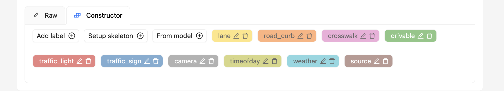
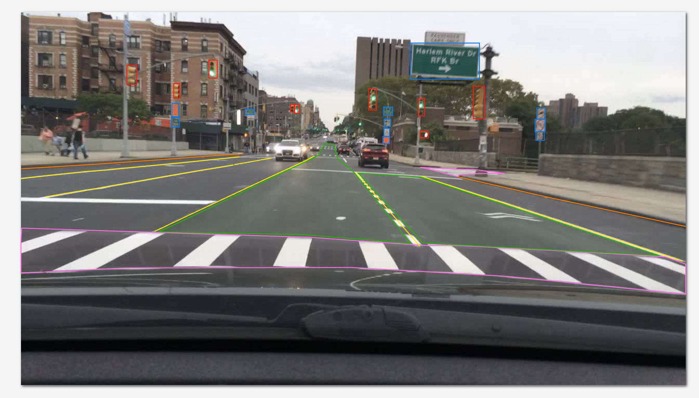
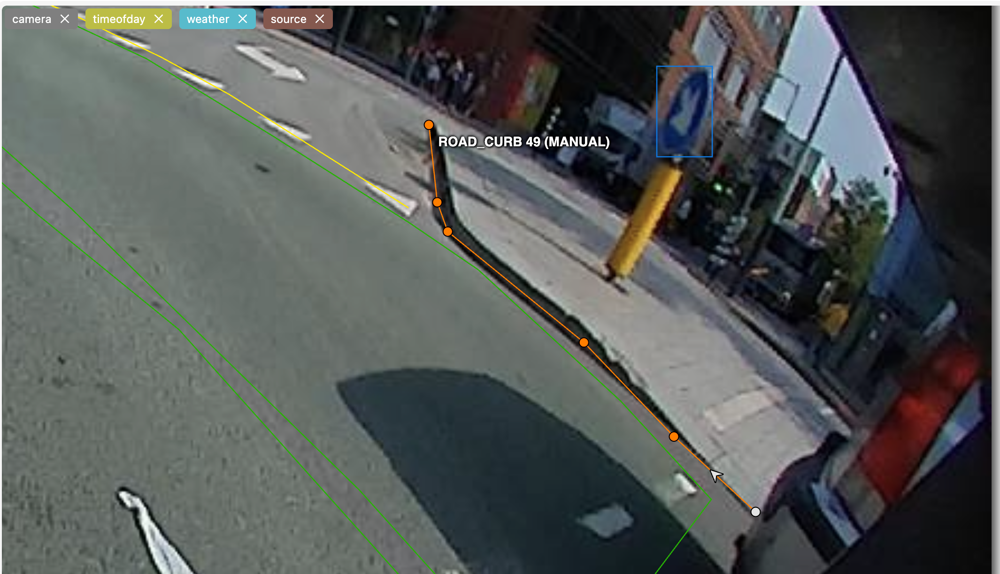
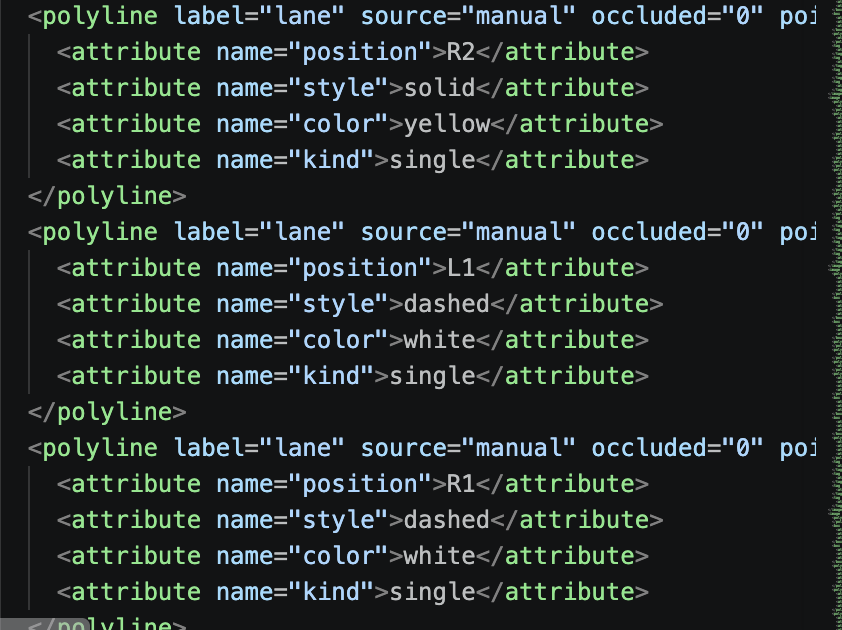

# Báo cáo cá nhân — Ngày 11
Họ tên: Lê Tiến Bình               Mã học viên: 2A202603346  
Phiên bản CVAT (Help → About): 2.82.1 (CVAT chạy local bằng Docker, `localhost:8080`)  
Guideline: Road v1.0    Lần nộp (`revision` trong manifest): 1  
Thời điểm export (ngày giờ trên CVAT): 21/11/2026 00:22 (giờ Việt Nam; 20/11/2026 17:22 UTC) cho task front; fisheye 20/11/2026 23:54    Số lần nộp lại sau Rework: 0

## 1. Kiểm project
| Mục | Đúng như guideline Road v1.0? | Ghi chú |
| --- | --- | --- |
| 6 label, đúng kiểu | Có | lane, road_curb (polyline); crosswalk, drivable (polygon); traffic_light, traffic_sign (rectangle). Dán từ `configs/road_v1_labels.json` vào tab Raw |
| Thuộc tính và giá trị | Có | Đối chiếu với output của `python -m road_lab.taxonomy`; `road_check lint` không báo label hay giá trị lạ (QC1-12) |
| 4 tag ảnh | Có | camera, timeofday, weather, source; mỗi tag là label kiểu Tag có một thuộc tính select `value` |

Cách kết thúc polyline trên bản CVAT này: bấm phím **N** sau khi click điểm cuối. Thứ tự click là thứ tự điểm được lưu, nên phải click điểm gần xe trước.  
Cách đặt tag ảnh trên bản CVAT này: chọn công cụ **Tag** ở thanh bên trái, chọn label rồi thêm; sau đó mở **Details** trong bảng Objects để chỉnh `value`. CVAT tự điền giá trị đầu danh sách (ví dụ `weather = clear`), nên phải kiểm lại từng tag.

## 2. Số lượng đã gán
| Task | Ảnh | lane | road_curb | crosswalk | drivable | traffic_light | traffic_sign |
| --- | ---: | ---: | ---: | ---: | ---: | ---: | ---: |
| front | 12 | 35 | 12 | 7 | 24 | 25 | 34 |
| front-extra (đã làm 4 / 4) | 4 | 11 | 2 | 5 | 8 | 8 | 12 |
| fisheye | 8 | 11 | 16 | 13 | 13 | 6 | 7 |
| fisheye-extra (đã làm 4 / 4) | 4 | 0 | 7 | 5 | 6 | 1 | 1 |

CVAT export từng task ra một file riêng, nên tôi ghép front + front-extra thành `letienbinh-front.zip` và fisheye + fisheye-extra thành `letienbinh-fisheye.zip`. Khi ghép, phần `meta` của task chính được giữ nguyên, còn `id` của ảnh được đánh số lại cho liên tục.

## 3. Bảng ca khó
| Ảnh | Nhãn | Phân vân giữa | Đã chọn | Lý do |
| --- | --- | --- | --- | --- |
| A01 | drivable, lane | Vùng giữa R1 và vạch vàng là lề (làn khẩn cấp) hay làn xe chạy | Vạch vàng = lane R2 (solid, yellow); vùng R1–R2 = `alternative`; dải xám ngoài vạch vàng tới lan can không vẽ drivable | Bề rộng giữa R1 và vạch vàng bằng một làn xe, còn lề thật nằm ngoài vạch vàng. Guideline mục 3: drivable không gồm lề. Vạch sơn mép đường là `lane`, không phải road_curb (QCVN 41:2024, vạch 3.1) |
| A01 | traffic_sign | Ô cam nhỏ in trên biển xanh có phải biển phụ không | Một hộp cho cả biển, `group = information` | Ô cam in trên cùng tấm biển, không phải tấm riêng, nên không có hộp `supplementary` |
| A03 | lane | Vẽ các gạch chéo xương cá của đảo sơn hay không; vạch vàng ngoài là L2 hay vạch đôi | Chỉ vẽ vạch vàng dọc sát làn mình là L1; không vẽ gạch chéo | Guideline định nghĩa `lane` là vạch kẻ làn; bản nháp GT chỉ lấy vạch `parallel` của BDD100K và bỏ vạch `vertical` (`bdd_to_cvat_road.py`). Guideline chưa có quy tắc cho đảo sơn, nên ghi lại để hỏi lead |
| A03 | traffic_sign | Biển cam hình thoi và biển vàng-xanh thuộc nhóm nào | Cả hai `group = warning` | Guideline xếp biển công trường màu cam và biển trường học / người đi bộ vào nhóm cảnh báo |
| A03, A07 | traffic_light | Đèn ở xa có bắt buộc gán không | Gán khi vỏ đèn cao từ 8 px; hộp ôm cả vỏ đèn | Quy tắc 8 px của guideline. `lint` báo 2 hộp ở A07 thấp hơn 8 px (không bắt buộc) |
| A07 | lane | Mép trái sát dải bê tông là road_curb hay lane | lane L1 (solid, white) trên vạch trắng mờ | Phóng to ảnh gốc thấy vạch sơn mờ sát chân dải bê tông. Có vạch sơn thì không gán road_curb |
| A07 | lane | Vạch liền và vạch đứt có gạch nối: vạch đôi hay hai vạch | Hai polyline riêng R1, R2; không vẽ gạch nối | Hai vạch cách nhau khoảng 1/3 làn, không phải vạch đôi sát nhau. Gạch nối là vạch ngang |
| A05, A06, A09, A12, A14, A16 | lane | `lint` báo thiếu L1 hoặc R1 (QC1-02) | Không vẽ thêm vạch | Ảnh không có vạch sơn ở bên đó (A05 không có vạch nào; A12 xe đang ở giữa ngã tư). Theo checkpoint, ca này cần coach xác nhận để được miễn |
| B03 (fisheye_rear) | lane | Camera sau đảo trái/phải: L/R tính theo bên trái/phải của ảnh hay của xe | Tính theo bên trái/phải trên ảnh (vạch đứt giữa đường = R1) | Guideline mục 4 chỉ nói L1/R1/L2/R2 dùng cho fisheye_front và fisheye_rear, không nói trục trái/phải. Cần lead xác nhận vì sai `position` là lỗi nặng |
| B05–B08 | lane | position L1 hay other ở camera hai bên | `other` | Guideline mục 4: ở fisheye_left và fisheye_right luôn dùng `position = other` |

## 4. Phiếu QC 1 nhận được
Bạn kiểm lô của tôi: Ninh Hải Nam (ninhhainam)  Quyết định nhận được: **Rework** (lỗi chính 9 / 99 nhãn = 9,1 %, không có lỗi nặng; 6 ảnh mẫu A01, A05, A08, B02, B03, B05)

| Mã lỗi | Số lỗi | Đồng ý? | Đã sửa? |
| --- | ---: | --- | --- |
| QC1-04 (A08: 3 polyline vẽ từ xa về gần, điểm đầu (772,317), (655,321), (644,310)) | 3 | Đồng ý. `lint` của tôi cũng báo đúng 3 polyline này. Riêng polyline (644,310) chỉ dài khoảng 15 px, là đoạn vẽ thừa, nên xoá chứ không đảo chiều | Chưa |
| QC1-05 (A01: vạch đôi L2 vẽ thành 2 polyline) | 1 | Đồng ý. Theo guideline vạch đôi là 1 polyline đặt giữa hai nét, `kind = double` | Chưa |
| QC1-11 (B02: 2 đèn, B03: 1 biển, B05: 2 biển chưa bật `edge_zone`) | 5 | Đồng ý. Tâm hộp nằm ngoài 80 % bán kính vòng ảnh, `lint` cũng gợi ý như vậy | Chưa |
| Ca mơ hồ A05 (thiếu L1/R1) | — | Đồng ý cần coach xác nhận; ảnh không có vạch sơn nào | Chờ coach |

Ghi chú: tôi đồng ý với cả 9 lỗi. Tôi chưa sửa kịp trong buổi, nên lô vẫn là `revision 1`. Khi sửa, tôi sẽ cất bản cũ vào `r1/` (manifest đổi tên thành `letienbinh-manifest-r1.json`), export lại với cùng tên zip và tạo manifest `--revision 2`. Cùng lúc tôi sẽ sửa thêm các lỗi cùng loại mà `lint` báo ngoài 6 ảnh mẫu: lane vẽ ngược ở A03, A07, A10, A11, A13, A16; vạch đôi tách ở A04, A09, A11, A14; `edge_zone` ở B04, B10.

## 5. Kiểm file export
| File | Mở lại được? | Số shape ảnh 1 (job / file) | Số shape ảnh 2 (job / file) | Tag camera có trong XML? |
| --- | --- | --- | --- | --- |
| `letienbinh-front.zip` | Có. `road_check lint` đọc được 16 ảnh, không có lỗi QC1-12 về file | A01: 11 / 11 | A02: 7 / 7 | Có (`front` ở cả 16 ảnh) |
| `letienbinh-fisheye.zip` | Có. `road_check lint` đọc được 12 ảnh, không có lỗi QC1-12 về file | B01: 6 / 6 | B02: 8 / 8 | Có (`fisheye_front` / `_rear` / `_left` / `_right` theo hậu tố FV / RV / MVL / MVR) |

Số shape phía "job" đếm trực tiếp trong CVAT; phía "file" đếm trong `annotations.xml` sau khi export. Manifest `letienbinh-manifest.json`: `contains_images = false` ở cả hai file, 28 / 28 ảnh đủ bốn tag, 0 ảnh chưa gán. Lúc tạo manifest, lint đếm được 8 cảnh báo nặng (đều là QC1-02 ở các ảnh ghi trong mục 3), 27 chính, 3 nhẹ.

## 6. Ảnh chụp màn hình
1. Tab Labels của project (Constructor): đủ 6 label vẽ và 4 label Tag.

   

2. Một ảnh camera trước đã gán đủ (làn, vùng lái, đèn/biển): A08, có lane, drivable, crosswalk, road_curb, đèn và biển.

   

3. Một ảnh fisheye đã gán, phóng to đoạn polyline cong: `road_curb` đặt điểm dày theo cung mép vỉa hè.

   

4. Một đoạn XML có <polyline label="lane">.

   

   Đoạn trích từ `letienbinh-front.zip` (A01):

```xml
<polyline label="lane" source="manual" occluded="0" points="1280.00,705.10;865.17,607.07;552.54,530.95;461.25,510.35" z_order="0">
  <attribute name="position">R2</attribute>
  <attribute name="style">solid</attribute>
  <attribute name="color">yellow</attribute>
```

## 7. Tự đánh giá
Lỗi bạn mắc nhiều nhất hôm nay (theo mã QC1-xx), và cách tránh ở Ngày 20:

Lỗi tôi mắc nhiều nhất là **QC1-04, vẽ polyline từ xa về gần** (khoảng 10 lane). Lỗi thứ hai là **QC1-05, vạch đôi vẽ thành 2 polyline** (5 ảnh). Nguyên nhân: tôi quen click theo hướng nhìn, từ chỗ hội tụ xuống, và nghĩ vạch đôi gồm hai vạch. Ở Ngày 20, tôi sẽ:
- luôn click điểm đầu tiên ở đáy ảnh;
- vẽ vạch đôi bằng một polyline đặt giữa hai nét;
- chạy `road_check lint` sau mỗi 3–4 ảnh thay vì đợi tới lúc export;
- với ảnh fisheye, kiểm `edge_zone` ngay khi vẽ hộp.

Nhãn của bạn đi vào model ở đâu? Chọn một lỗi đã sửa và nói nó làm model học sai thế nào:

Polyline làn là nhãn huấn luyện cho model phát hiện làn (lane detection, ví dụ dạng row-anchor). Model học vị trí x của từng vạch trên mỗi hàng ảnh, cùng vai trò của vạch (L1/R1 là hai mép làn xe đang đi). Đầu ra này đi vào hệ thống giữ làn (LKA).

Lỗi đã sửa tôi chọn: ở B05–B08 (camera fisheye trái và phải), ban đầu tôi gán lane là L1/L2. Theo guideline, các lane này phải là `other`, và tôi đã sửa lại. Nếu để L1/L2, model sẽ học rằng vạch nhìn thấy từ camera bên hông là mép làn xe đang đi. Khi xe chạy cạnh một vạch ở làn bên cạnh, model có thể nhận vạch đó là L1 và LKA bám nhầm vạch, kéo xe lệch sang làn khác. Đây là lý do sai `position` được xếp mức nặng.

## 8. (Tùy chọn, buffer) Từ polyline đến đích row-anchor
Không làm (hoạt động tùy chọn, không tính điểm).
